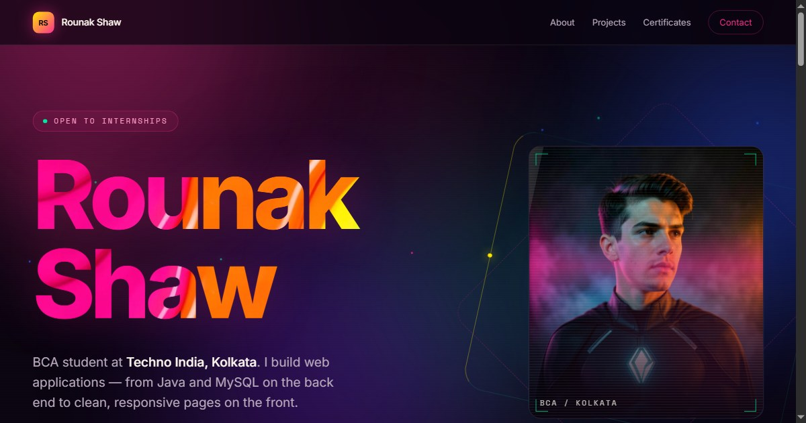

<div align="center">

# Rounak Shaw · Portfolio

**A personal portfolio for my education, skills, projects, and certifications.**

[](https://rounakshaw2004.github.io/potfolio/)
[](https://github.com/rounakshaw2004)
[](https://linkedin.com/in/rounak-shaw-271a16321)

<br />

<a href="https://rounakshaw2004.github.io/potfolio/">
  
</a>

</div>

## About

I’m **Rounak Shaw**, a BCA student at **Techno India, Kolkata**. This portfolio introduces my background and current interests in web development, Java, databases, and cloud computing. It is built with plain HTML, CSS, and JavaScript, with no front-end framework or build step.

## What’s inside

- **About and skills:** Education, background, and technologies including HTML, CSS, JavaScript, Java, JSP/Servlets, MySQL, JDBC, and AWS fundamentals.
- **Selected projects:** A Java and MySQL Placement Management System and this portfolio site.
- **Certifications:** Eight listed courses in cloud computing, cybersecurity, generative AI, and web development.
- **Career focus:** Current learning goals and internship availability.
- **Contact:** A direct LinkedIn link for professional enquiries.

## Design and interactions

- Responsive dark interface with a neon-inspired visual theme.
- Single-page navigation to About, Projects, Certificates, and Contact.
- Animated section reveals, skill counters, a typing code panel, and interactive project cards.
- Reduced-motion handling for key decorative animations.
- Search and social sharing metadata, plus a web app manifest.

## Tech stack

| Area | Tools |
|:--|:--|
| Structure | HTML5 |
| Styling | CSS3, responsive layouts, CSS animations |
| Interactions | Vanilla JavaScript, Intersection Observer, requestAnimationFrame |
| Hosting | GitHub Pages with GitHub Actions |

## Run locally

No dependencies or build command are required.

1. Clone the repository:

   ```bash
   git clone https://github.com/rounakshaw2004/potfolio.git
   cd potfolio
   ```

2. Open `index.html` in a browser, or open the folder in VS Code and run it with the Live Server extension.

## Customize

- **Portfolio content and links:** Edit the relevant sections in `index.html`. Update the LinkedIn URLs in the contact area and footer when your profile link changes.
- **Images:** Replace files in `images/` while keeping their current filenames, or update the matching image paths in `index.html`.
- **Social preview:** Replace `og-image.jpg` and keep its dimensions at 1200 × 630 pixels, then update the Open Graph metadata in `index.html` if the public site URL changes.
- **Browser app metadata:** Edit `manifest.json` if you change the app name or related settings.

## Deploy with GitHub Pages

The workflow at `.github/workflows/pages.yml` publishes the repository when changes are pushed to `main`. In the repository’s **Settings → Pages**, choose **GitHub Actions** as the deployment source if it is not already selected.

After a successful deployment, visit [rounakshaw2004.github.io/potfolio](https://rounakshaw2004.github.io/potfolio/).

## Repository structure

```text
.
├── .github/workflows/pages.yml  # GitHub Pages deployment
├── images/                      # Portfolio and project artwork
├── index.html                   # Site markup, styles, and interactions
├── manifest.json                # Web app metadata
├── og-image.jpg                 # Social sharing preview image
└── worker.js                    # Static asset request handler
```

## Contact

- **Portfolio:** [rounakshaw2004.github.io/potfolio](https://rounakshaw2004.github.io/potfolio/)
- **LinkedIn:** [Rounak Shaw](https://linkedin.com/in/rounak-shaw-271a16321)
- **GitHub:** [@rounakshaw2004](https://github.com/rounakshaw2004)
